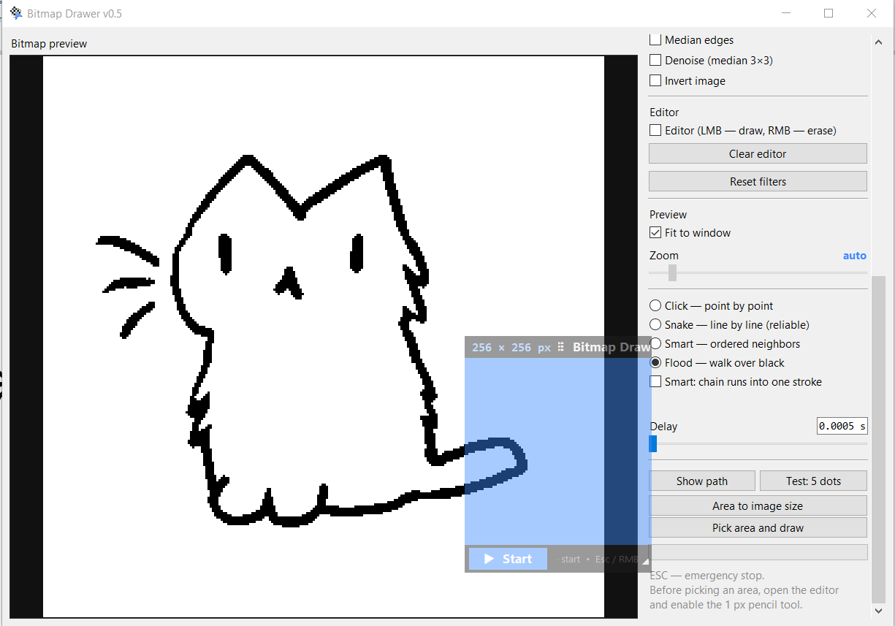
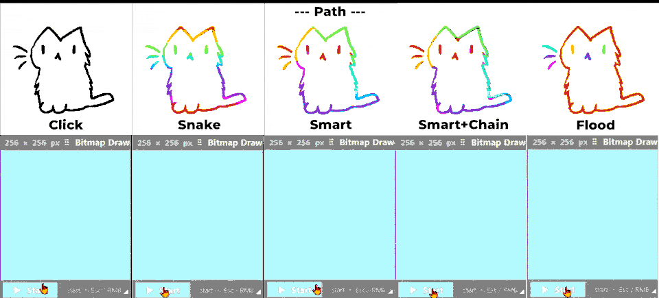
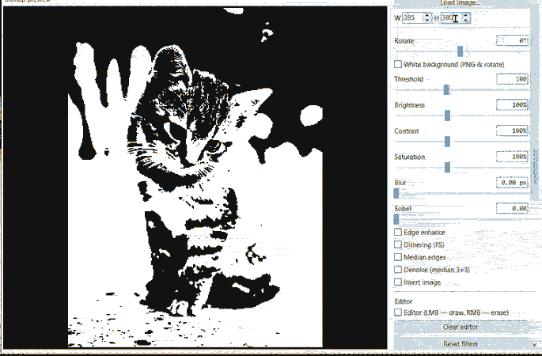

# Bitmap Drawer 🖱️🎨
*(Also known as a modern, open-source alternative to ImageToMouse)*


<details open>
<summary><b>🇬🇧 Read in English (Click to collapse)</b></summary>

  **Bitmap Drawer** — is a powerful tool that automatically draws black-and-white images on any virtual canvas using simulated mouse movements. 

If you are looking for an **ImageToMouse** alternative that works flawlessly without external websites, handles complex images, and allows you to stop the process with a hotkey — this is the tool for you. Perfect for creating pixel art, drawing in MS Paint/Krita, or automating GUI testing.



## ✨ Features
*   **Image Processing:** Load any image, apply filters (Threshold, Dithering, Brightness, Contrast, Blur, Sobel edges, Median noise reduction) and resize it to fit your canvas.
*   **4 Drawing Algorithms:**
    *   `Click` — point-by-point clicking (reliable, but slow).
    *   `Snake` — line-by-line drawing (fast and predictable).
    *   `Smart` — smart ordering of horizontal lines to minimize mouse travel.
    *   `Flood` — walks through connected black areas, returning over already painted pixels to avoid lifting the mouse button.
*   **Built-in Editor:** Draw or erase pixels directly in the preview window (LMB to draw, RMB to erase).
*   **Smart Area Selection:** Drag, resize, and position the drawing area over any window.
*   **Emergency Stop:** Press `ESC` at any time to instantly stop the drawing process.
*   **Localization:** Supports English and Russian out of the box.

## 🎬 Demo
*Comparing drawing modes (Click, Snake, Smart, Flood):*


*Adjusting image filters in real-time:*


## 🚀 How to Use (Ready-to-run build)
1. Go to the [Releases](../../releases) page.
2. Download the latest `BitmapDrawer.zip` archive or one executable file `BitmapDrawer.exe`.
3. Extract the archive to any folder on your PC.
4. Run `BitmapDrawer.exe`. No Python installation is required.

## 🛠️ How to Run from Source
If you want to run or modify the source code, you'll need Python 3.8 or newer.
1. Clone the repository:
   ```bash
   git clone https://github.com/your-username/BitmapDrawer.git
   cd BitmapDrawer
   ```
2. Install dependencies:
   ```bash
   pip install pillow numpy pynput
   ```
3. Run the script:
   ```bash
   python src/bitmap_drawer.py
   ```
   
## 📦 How to Build the .exe
To compile the app into a standalone executable using PyInstaller:
```bash
pip install pyinstaller
	pyinstaller --noconsole --onedir --name="BitmapDrawer" --icon="assets/icon.ico" --add-data "assets/icon.ico;." src/bitmap_drawer.py
```
## ⚙️ Configuration & Localization
The program stores its settings in `bitmap_drawer.json` located next to the `.exe`.  
To change the language, simply replace the `lang.json` file with `lang_en.json` (or vice versa). You can also create your own `lang.json` by translating the values.

**Advanced users:** You can tweak internal engine parameters (like `flood_max_pixels` or `countdown_seconds`) by adding a `"params"` block to `bitmap_drawer.json`.

## ⌨️ Controls

- **Left Mouse Button (LMB):** Draw in the editor / Select area.
    
- **Right Mouse Button (RMB):** Erase in the editor / Cancel area selection.
    
- **ESC:** Emergency stop during drawing.
    
- **Enter:** Confirm area selection.
</details>
<details> <summary><b>🇷🇺 Читать на русском (Нажмите чтобы развернуть)</b></summary>

**Bitmap Drawer** — это мощный инструмент, который автоматически переносит чёрно-белые изображения на любой виртуальный холст с помощью симуляции движений мыши.

Если вы ищете **альтернативу ImageToMouse**, которая работает безупречно без внешних сайтов, справляется со сложными изображениями и позволяет остановить процесс горячей клавишей — этот инструмент для вас. Идеально подходит для создания пиксель-арта, рисования в MS Paint/Krita или автоматизации тестирования интерфейсов.


## ✨ Возможности

- **Обработка изображений:** Загружайте любые картинки, применяйте фильтры (Порог, Дизеринг, Яркость, Контраст, Размытие, Выделение краёв Собелем, Медианное сглаживание) и изменяйте размер под ваш холст.

- **4 алгоритма рисования:**
    *   `Click` — поточечные клики (надёжно, но медленно).
    *   `Snake` — рисование строка за строкой (быстро и предсказуемо).
    *   `Smart` — умный порядок горизонтальных линий для минимизации перемещений мыши.
    *   `Flood` — проход по связанным чёрным областям с возвратом по уже закрашенным пикселям, чтобы избежать отрыва кнопки мыши.
*   **Встроенный редактор:** Рисуйте или стирайте пиксели прямо в окне предпросмотра (ЛКМ — рисовать, ПКМ — стирать).
*   **Умный выбор области:** Перетаскивайте, изменяйте размер и позиционируйте область рисования поверх любого окна.
*   **Аварийная остановка:** Нажмите `ESC` в любой момент, чтобы мгновенно остановить процесс рисования.
*   **Локализация:** Поддерживает русский и английский языки «из коробки».
    

## 🎬 Демонстрация

_Сравнение режимов рисования (Click, Snake, Smart, Flood):_  


_Настройка фильтров в реальном времени:_  


## 🚀 Как использовать (Готовая сборка)

1. Перейдите на страницу [Releases](https://../releases).
    
2. Скачайте последний архив `BitmapDrawer.zip` или одиночный файл `BitmapDrawer.exe`.
    
3. Распакуйте архив в любую папку на вашем ПК (если используете версию с zip).
    
4. Запустите `BitmapDrawer.exe`. Установка Python не требуется.
    

## 🛠️ Как запустить из исходников

Если вы хотите запустить или изменить исходный код, вам понадобится Python 3.8 или новее.

1. Клонируйте репозиторий:
   ```bash
   git clone https://github.com/your-username/BitmapDrawer.git
   cd BitmapDrawer
   ```
2. Установите зависимости:
   ```bash
   pip install pillow numpy pynput
   ```
3. Запустите скрипт:
   ```bash
   python src/bitmap_drawer.py
   ```

## 📦 Как собрать .exe
Чтобы скомпилировать приложение в автономный исполняемый файл с помощью PyInstaller:
```bash
pip install pyinstaller
	pyinstaller --noconsole --onedir --name="BitmapDrawer" --icon="assets/icon.ico" --add-data "assets/icon.ico;." src/bitmap_drawer.py
```

## ⚙️ Конфигурация и локализация

Программа сохраняет настройки в файле `bitmap_drawer.json`, который находится рядом с `.exe`.  
Чтобы сменить язык, просто замените файл `lang.json` на `lang_en.json` (или наоборот). Вы также можете создать свой собственный `lang.json`, переведя значения.

**Для продвинутых пользователей:** Вы можете изменить внутренние параметры движка (например, `flood_max_pixels` или `countdown_seconds`), добавив блок `"params"` в `bitmap_drawer.json`.

## ⌨️ Управление

- **Левая кнопка мыши (ЛКМ):** Рисовать в редакторе / Выбрать область.
    
- **Правая кнопка мыши (ПКМ):** Стирать в редакторе / Отменить выбор области.
    
- **ESC:** Аварийная остановка во время рисования.
    
- **Enter:** Подтвердить выбор области.
    
</details>

📝 License

This project is licensed under the MIT License. / Этот проект распространяется под лицензией MIT.
